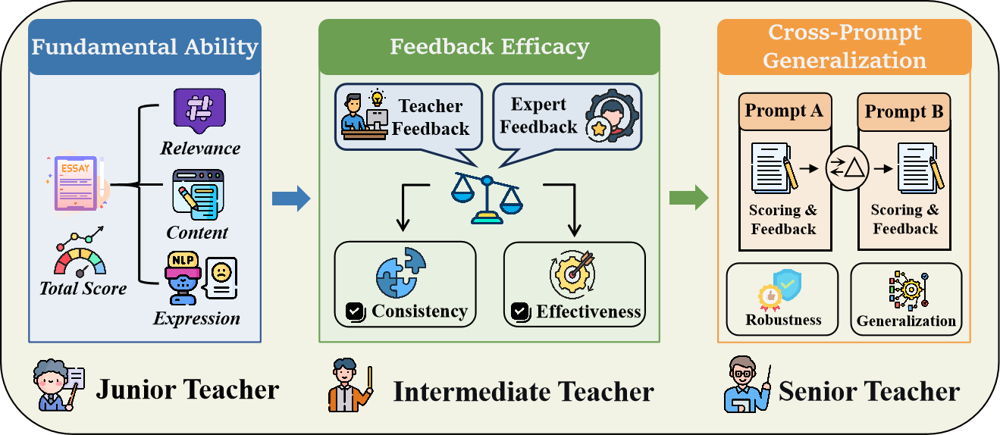

<div align="center">

# ✨ NarrativeBench: Benchmarking Multi-trait Automated Scoring and Feedback Efficacy of Large Language Models for Chinese Narrative Essays

<a href='https://github.com/AwakenPurity/NarrativeBench/'></a>
<a href='paper/NeurIPS_2026_NarrativeBench_Camera_Ready.pdf'></a>

</div>


 #### 🎉Our paper has been accepted to NeurIPS 2026 !!!

## 💭 Abstract

Automated scoring and feedback generation for Chinese narrative essays (CNE) represent a critical task in educational measurement. While Large Language Models (LLMs) have demonstrated transformative progress, their potential in CNE evaluation scenarios has yet to be systematically under-explored. Existing essay benchmarks face some challenges: 
- (1) **Standard Alignment**: The varied complexity of scoring traits and rubrics across different benchmarks makes it difficult to establish a consistent alignment mechanism for heterogeneous evaluation scenarios;
- (2) **Evaluation Scope**: Current benchmarks only focus on discriminative scoring accuracy for LLMs, yet they lack a systematic framework for assessing the quality of generative feedback.
- (3) **Prompt Coverage**: There is a lack of CNE datasets that cover both closed-ended and open-ended prompts. These issues have, to some extent, constrained the trust of educators in and their adoption of LLM-based methods for essay assessment.  

To bridge these gaps, we introduce **NarrativeBench**, a multi-trait and feedback-oriented evaluation benchmark for CNE. NarrativeBench covers both closed-ended and open-ended writing tasks and consists of 4,500 student essays from grades 3 to 5 across 14 different writing prompts. Finally, we benchmark 10 popular LLMs, revealing that their performance exhibits significant gaps compared to human evaluations and pretrained language models. Through NarrativeBench, we comprehensively assess LLM performance on Chinese narrative essay tasks, thus facilitating LLM progress in Chinese essay data analysis domains.

---

## 🤖 Definition of Evaluation Framework

- **Relevance** evaluates the degree of alignment between the essay content and the given prompt. It examines whether the student understands the task requirements and maintains a consistent focus throughout the narrative, thereby ensuring that the response is appropriate and on topic. 
- **Content** assesses the richness of narrative writing and the quality of word and sentence usage. This dimension emphasises the development of the storyline, the vividness of details, and the depth of emotional expression, reflecting the student’s ability to construct a coherent and engaging narrative arc.
- **Expression** evaluates language quality and stylistic choices, including sentence fluency, logical coherence in expression, lexical accuracy, and the presence of grammatical or syntactic errors, ensuring that language serves as an effective and refined medium for conveying the student's ideas.

In designing the evaluation protocol for **feedback quality**, we observe that traditional surface-level metrics such as BLEU and ROUGE are not suitable for assessing feedback quality, since instructional feedback is inherently open-ended and may contain multiple valid expressions with low lexical overlap but equivalent semantics.

In this work, we leverage the strong performance of large language models in pairwise comparison tasks and employ two independent LLMs (DeepSeek-V4-pro and Gemini-3.1-pro) as auxiliary judges to perform all pairwise evaluations. For each dimension, annotators compare `r_model(x_i^j)` with `r_ref(x_i^j)` and assign a ternary preference label:

- `S(x_i^j) = 1` if `r_model(x_i^j) ≻ r_ref(x_i^j)`
- `S(x_i^j) = 0` if `r_model(x_i^j) = r_ref(x_i^j)`
- `S(x_i^j) = -1` if `r_model(x_i^j) ≺ r_ref(x_i^j)`

where `r_model(x_i^j)` denotes the feedback generated by the model for the `j`-th dimension of the `i`-th essay, and `r_ref(x_i^j)` denotes the corresponding expert-written reference feedback. This comparison follows a unified evaluation guideline, focusing on the accuracy, relevance, and pedagogical usefulness of the feedback. We aggregate the pairwise comparison results across all test samples to compute the overall score for each model under each dimension:

`S_total = (N_win × 1) + (N_tie × 0) + (N_loss × -1)`

---

## 📢 Reference
Jin Wu. "NarrativeBench: Benchmarking Multi-trait Automated Scoring and Feedback Efficacy of Large Language Models for Chinese Narrative Essays", Advances in Neural Information Processing Systems (NeurIPS 2026).

## Bibtex
```bibtex
